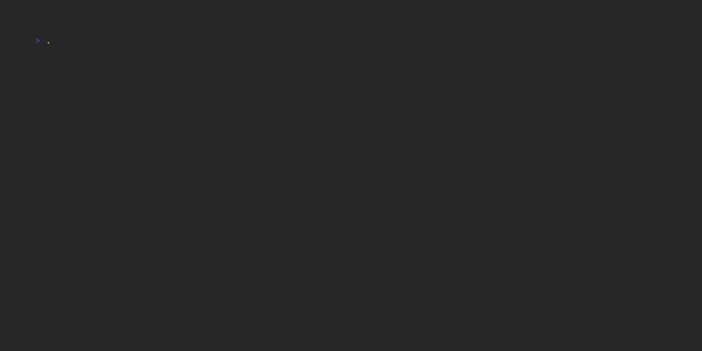

Terminal animation library for Go. Pure Go animations ready to use in your TUI applications.


## Effects

Effect names and text requirements match the registry in [`animations/registry.go`](animations/registry.go).

### Animations
Standalone effects that do not require text input.

- **Fire** (`fire`): DOOM PSX-style fire
- **Matrix Rain** (`matrix`): classic digital rain
- **Rain** (`rain`): falling ASCII characters
- **Fireworks** (`fireworks`): particle-based fireworks
- **Beams** (`beams`): full-screen light beams
- **Aquarium** (`aquarium`): underwater scene with fish and sea life
- **Skull** (`skull`): skull with a Tron grid, sonar pulses, and scanline sweep
- **Sonar** (`sonar`): pulses radiating from the centre to the screen edges
- **Cracktro** (`cracktro`): demoscene animation with stars, raster bars, and wireframe
- **SYSC Logo** (`sysc-logo`): spinning 3D braille wordmark
- **Cross Logo** (`cross-logo`): spinning 3D braille Latin cross
- **Logo Morph** (`logo-morph`): rotating SYSC wordmark and cross morph
- **AK-47** (`ak-47`): Lokeig's braille model with a particle swirl and reconstruction
- **Great Wave** (`great-wave`): Hokusai's wave with animated ASCII foam and water
- **Wasteland** (`wasteland`): animated ASCII scene after Valenberg

### Text Effects
Text effects animate ASCII input. The CLI uses `SYSC.txt` by default; pass `-file` to choose another file. Blackhole can also run in particle mode without text.

- **Fire Text** (`fire-text`): ASCII art consumed by rising flames
- **Matrix Art** (`matrix-art`): ASCII art revealed by Matrix-style streams
- **Rain Art** (`rain-art`): ASCII art revealed by falling rain
- **Beam Text** (`beam-text`): text with animated light beams
- **Ring Text** (`ring-text`): rotating coloured rings around ASCII art
- **Blackhole** (`blackhole`): text pulled into a swirling blackhole
- **Pour** (`pour`): characters fall into position from different directions
- **Print** (`print`): typewriter-style text rendering
- **Decrypt** (`decrypt`): scrambled text resolves into the supplied text
- **AK-47 Text** (`ak-47-text`): the braille model forms the selected ASCII art

## Installation

### CLI Tools

**Via one-line installer (fastest):**
```bash
curl -fsSL https://raw.githubusercontent.com/Nomadcxx/sysc-Go/master/install.sh | sudo bash
```

**Via interactive installer:**
```bash
# Clone and run the TUI installer (requires sudo for system-wide installation).
# Installs both syscgo and syscgo-tui binaries.
# Resolve Go in the current shell, then invoke that toolchain by absolute path.
git clone https://github.com/Nomadcxx/sysc-Go.git
cd sysc-Go
sudo "$(go env GOROOT)/bin/go" run ./cmd/installer/
```

**Via AUR (Arch Linux):**
```bash
yay -S syscgo
```

**Via Go:**
```bash
go install github.com/Nomadcxx/sysc-Go/cmd/syscgo@latest
go install github.com/Nomadcxx/sysc-Go/cmd/syscgo-tui@latest
```

> **Note:** The TUI binary includes the BIT fonts. `go install` does not install the sample text files; use the installer or AUR package for them.

### As Library

```bash
go get github.com/Nomadcxx/sysc-Go
```

## Quick Start

### Interactive TUI

The easiest way to browse and select animations is through the interactive TUI:

```bash
syscgo-tui
```


**Features:**
- Visual selector for all animations, themes, and durations
- Built-in ASCII art editor (BIT) with live preview
- 174 block-style fonts for creating ASCII art
- Real-time animation preview
- Export ASCII art to file (Ctrl+S)
- Navigate with arrow keys or vim keybindings (h/j/k/l)
- Instant theme switching

### Command Line

Run any animation directly from command line:

**Animations** (no text input required):
```bash
# Fire effect with Dracula theme (infinite loop)
syscgo -effect fire -theme dracula -duration 0

# Matrix rain with Nord theme for 30 seconds
syscgo -effect matrix -theme nord -duration 30

# Rain effect with Tokyo Night theme
syscgo -effect rain -theme tokyo-night

# Fireworks display
syscgo -effect fireworks -theme catppuccin -duration 20

# Beams effect (full-screen background)
syscgo -effect beams -theme nord -duration 0

# Aquarium effect (infinite)
syscgo -effect aquarium -theme dracula -duration 0

# AK-47: repeating 12-second cycle
syscgo -effect ak-47 -theme kanagawa -duration 0

# Use selected artwork as the braille-particle target
syscgo -effect ak-47-text -file /path/to/art.txt -theme kanagawa -duration 0
```

**Text Effects** (require `-file` flag with text/ASCII art):
```bash
# Fire text effect with ASCII art
syscgo -effect fire-text -file logo.txt -theme rama -duration 0

# Matrix art effect
syscgo -effect matrix-art -file art.txt -theme eldritch -duration 20

# Rain art effect
syscgo -effect rain-art -file banner.txt -theme tokyo-night -duration 15

# Pour effect with text file
syscgo -effect pour -file message.txt -theme gruvbox -duration 10

# Print effect (typewriter style)
syscgo -effect print -file banner.txt -theme catppuccin -duration 15

# Beam text effect with auto-sizing and display mode
syscgo -effect beam-text -file header.txt -auto -display -theme nord -duration 5

# Ring text effect
syscgo -effect ring-text -file title.txt -theme eldritch -duration 10

# Blackhole effect with text
syscgo -effect blackhole -file text.txt -theme dark -duration 15
```

**Available themes:** dracula, gruvbox, nord, tokyo-night, catppuccin, material, solarized, monochrome, transishardjob, rama, eldritch, dark

**Text Effect Flags:**
- `-auto` - Auto-size canvas to fit text (beam-text only)
- `-display` - Complete once and hold at final state (beam-text only)
- `-file` - Path to text file for text-based effects

## Asset Directories

When using text effects with `-file`, syscgo searches for files in the following order:

1. **Absolute path** - If you provide a full path (e.g., `/home/user/art.txt`)
2. **Current directory** - Files in your working directory
3. **User assets** - `~/.local/share/syscgo/assets/` (where new art is saved)
4. **System assets** - `/usr/local/share/syscgo/assets/` or `/usr/share/syscgo/assets/`

**Where your ASCII art is saved:**

When you create ASCII art using the TUI (syscgo-tui) and export it, files are saved to:

```
~/.local/share/syscgo/assets/
```

Set `XDG_DATA_HOME` to save under a different data root. If you already keep a
`~/sysc-Go/assets/` directory from a source checkout, exports keep going there.

**Example usage:**
```bash
# Create art in TUI
syscgo-tui
# Use BIT editor, export as "hyprland.txt"

# Use your exported art
syscgo -effect fire-text -file hyprland.txt -theme rama -duration 0
```

For sysc-walls integration, art exports to `~/.config/sysc-walls/ascii/` instead.

## Effect Showcase

The images below show selected effects. Use the effects list above for the full catalog.

### Animations

#### Fire


#### Matrix Rain


#### Rain


#### Fireworks


#### Beams


#### Aquarium


### Text Effects

#### Fire Text


#### Matrix Art


#### Rain Art


#### Beam Text


#### Ring Text


#### Blackhole


## Live Preview

Run an effect in a terminal. Press `Ctrl+C` to stop it.

```bash
syscgo -effect great-wave -theme nord -duration 0
syscgo -effect decrypt -file assets/SYSC.txt -theme nord -duration 0
```

## Documentation

See [GUIDE.md](GUIDE.md) for detailed CLI usage.

## Acknowledgements

- [terminaltexteffects](https://github.com/ChrisBuilds/terminaltexteffects) - Inspiration for terminal visual effects
- [bit](https://github.com/superstarryeyes/bit) - ASCII art editor and font library integration

## License

Code: MIT. The bundled AK-47 model data is by Lokeig and retains
[CC BY-NC 4.0](https://creativecommons.org/licenses/by-nc/4.0/), including its
noncommercial restriction. See [model credits and conversion](animations/models/README.md).

---

<a href="https://github.com/Nomadcxx"></a> — terminal-native tooling for the linux desktop.
[More projects →](https://github.com/Nomadcxx) · [Sponsor](https://github.com/sponsors/Nomadcxx) ❤️
